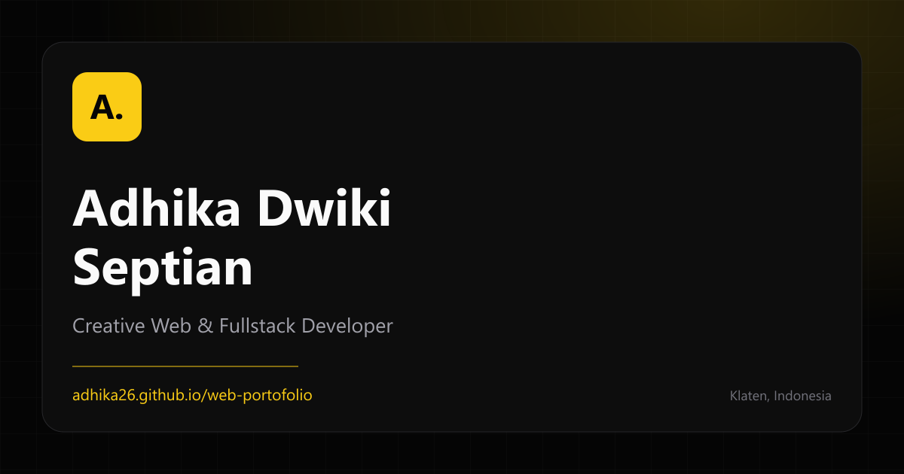

# Web Portfolio - Adhika Dwiki Septian

Website portofolio pribadi untuk menampilkan profil, project, sertifikat, dan CV. Dibangun sebagai situs statis dengan Vite, Tailwind CSS, dan JavaScript, lalu di-deploy ke GitHub Pages.

**Live:** https://adhika26.github.io/web-portofolio/



## Fitur

- Layout responsif dari mobile sampai desktop.
- Tema gelap dengan aksen kuning.
- Dropdown CV bahasa Indonesia dan Inggris.
- Showcase project dengan screenshot dan tautan repository.
- Filter skill berdasarkan kategori.
- Galeri sertifikat dengan tautan PDF.
- Form kontak melalui `mailto:` dengan validasi dan fallback.
- SEO dasar: canonical, Open Graph, Twitter Card, JSON-LD, robots, dan sitemap.
- Manifest PWA dan ikon untuk perangkat mobile.
- Gambar project dalam format AVIF/WebP dengan `srcset`.

## Stack

- Vite 8
- Tailwind CSS 4
- JavaScript ES Modules
- HTML partials
- GitHub Pages
- Sharp untuk optimasi gambar

## Menjalankan Proyek

```bash
npm install
npm run dev
```

Build produksi:

```bash
npm run build
npm run preview
```

## Script

| Script | Fungsi |
|---|---|
| `npm run dev` | Menjalankan server development Vite |
| `npm run build` | Build situs ke folder `dist` |
| `npm run preview` | Melihat hasil build secara lokal |
| `npm run optimize:images` | Membuat varian AVIF/WebP untuk gambar project |
| `npm run deploy` | Build lalu publish `dist` ke branch `gh-pages` |

## Struktur

```text
public/                 Aset statis: CV, sertifikat, project, ikon, manifest
scripts/                Script optimasi gambar
src/
  sections/             Partial HTML per bagian halaman
  assets/               Aset sumber
  main.js               Interaksi: menu, filter skill, dropdown CV, form
  style.css             Tailwind dan style komponen
docs/
  QA_TEST_PLAN.md       Rencana dan checklist pengujian
  QA_FIXES.md           Laporan perbaikan QA
index.html              Entry HTML dan meta SEO
vite.config.js          Konfigurasi Vite dan plugin HTML partials
```

## Deployment

Situs di-deploy ke GitHub Pages melalui package `gh-pages`:

```bash
npm run deploy
```

Perintah tersebut menjalankan build, lalu mengirim isi `dist` ke branch `gh-pages`.

## Konten

- CV Indonesia: `/cv/cv-id.pdf`
- CV Inggris: `/cv/cv-en.pdf`
- Sertifikat: `/certificates/`
- Screenshot project: `/projects/`

## Dokumentasi QA

- [QA Test Plan](docs/QA_TEST_PLAN.md)
- [Laporan Perbaikan QA](docs/QA_FIXES.md)

## Kontak

- GitHub: [github.com/adhika26](https://github.com/adhika26)
- LinkedIn: [linkedin.com/in/adhikads](https://www.linkedin.com/in/adhikads)
- Email: [adhikaseptian5@gmail.com](mailto:adhikaseptian5@gmail.com)
